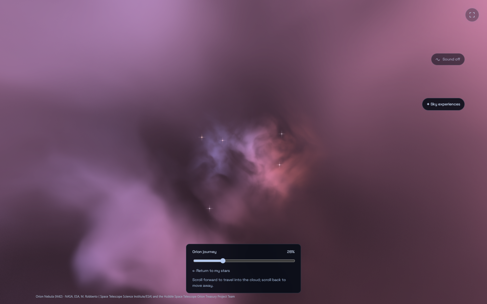
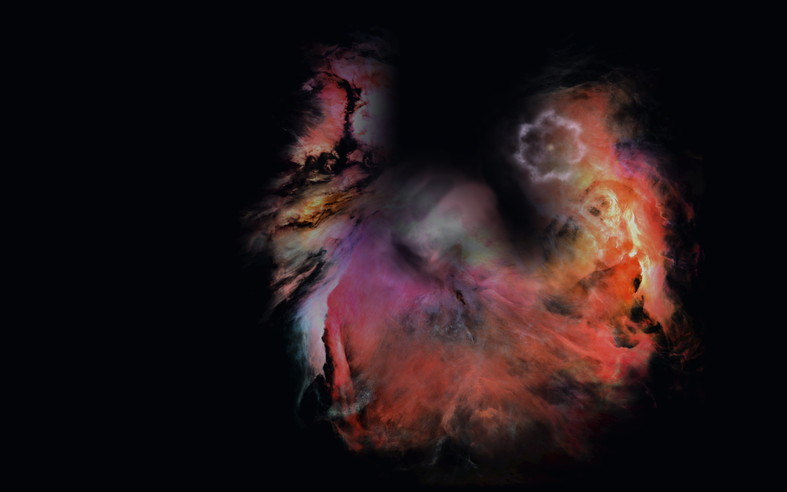
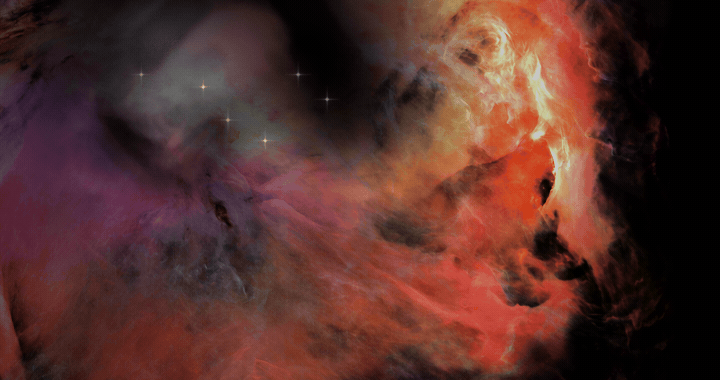
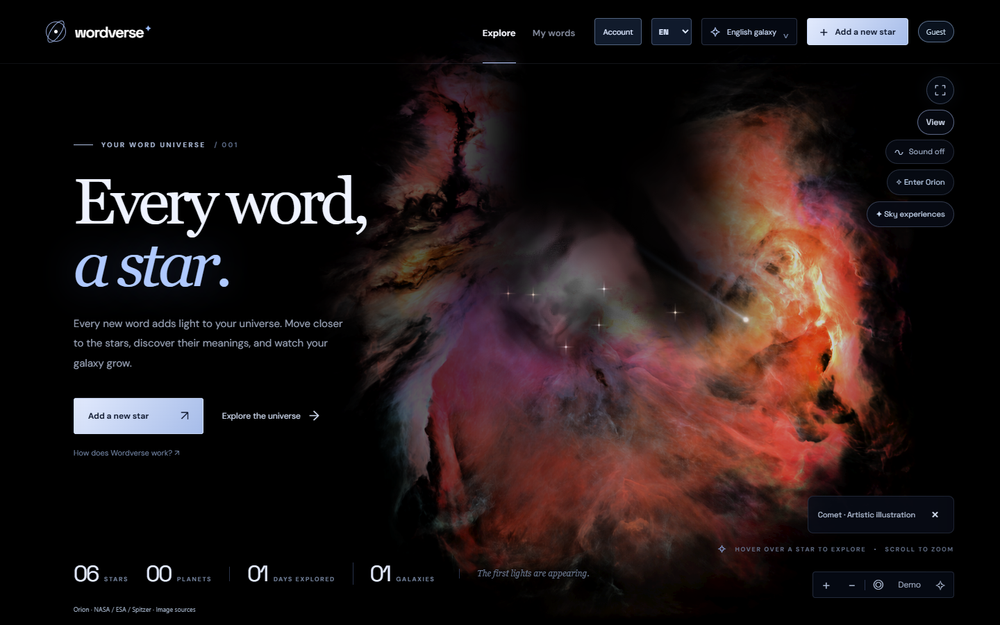
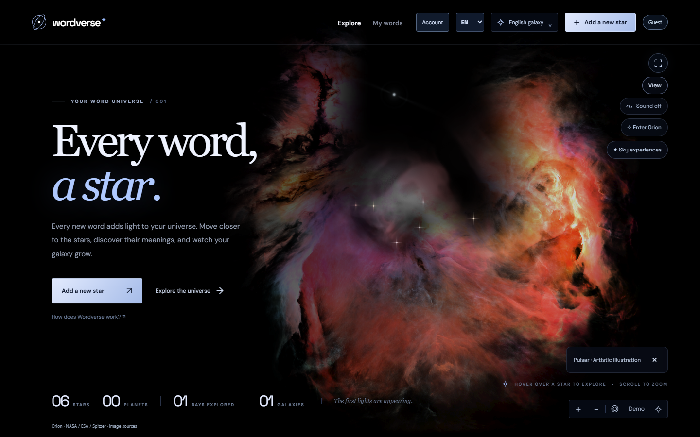
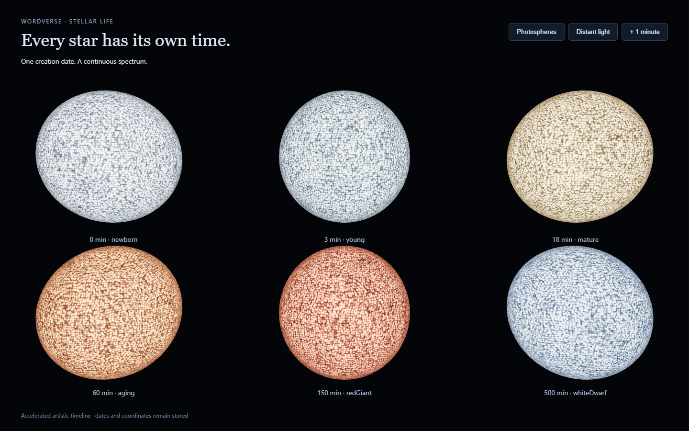

<p align="center"><strong>W O R D V E R S E</strong><br />A word. A star. A universe.</p>

<p align="center"><a href="https://wordverse-galaxy.vercel.app">Open Wordverse</a> · <a href="docs/GUIDE.tr.md">Türkçe rehber</a> · <a href="CONTRIBUTING.md">Contribute</a></p>

[](https://github.com/GhostFelina/wordverse-galaxy/actions/workflows/check.yml) · [MIT code license](LICENSE)


**Turn the words you learn into a universe you can explore.** Add a word, find its star, approach its surface and reveal its meaning when you are ready. Wordverse pairs a personal vocabulary atlas with a cinematic Three.js scene.

The live app runs **1.14.1**. The screenshots and features below describe **1.22.1 development** on [`phase/4-universe`](https://github.com/GhostFelina/wordverse-galaxy/tree/phase/4-universe), ahead of production. All gallery records are synthetic.

## Explore, remember, share

| Experience | What you can do |
| --- | --- |
| Your word stars | Keep words in language galaxies, watch independent distant scintillation and creation-date colors, select a star and approach its granular surface. Stored positions and dates stay stable. |
| Orion flight | Enter Orion with every word star from the active language galaxy. Explore a wider, deeper gas volume with the wheel or depth slider; focus any star inside and return in one action. |
| A useful atlas | Search, filter words and conjunctions, sort naturally or by date, and return to the same list after opening a record. |
| Short recall | Reveal a meaning, self-assess and revisit difficult words. Sessions are ephemeral; this is not a spaced-repetition scheduler. |
| Star cards | Download a 1080px square or portrait PNG of one chosen word. Meanings stay off until explicitly included. |
| A living sky | A restrained shuffled sequence brings meteors, supernovae, comets, pulsars, a distant red accretion disk and neutron-star mergers into different sky positions. Choose any event yourself or switch to quiet sky; events never change your records. |
| Sound of your universe | Enable an original cinematic atmosphere with spatial headphone cues, stereo speaker mode and depth-dependent reverberation. Creation, editing and deletion have distinct cues after durable storage. Sound starts with your gesture. |
| Built for the browser | Turkish, English and Spanish; keyboard navigation, an explicit animation preference, reduced motion, local fonts, adaptive graphics and an atlas fallback. |

<p> </p>

<p> </p>

<details><summary>Watch distant starlight</summary>



The visible cores and halos breathe at independent rhythms while their positions stay fixed. This native browser capture uses old records over Orion; the stars retain a visible light minimum. Choose **View → Animations → Living stars and sky** to enable it, or choose reduced motion for a still scene.

</details>

<details><summary>A comet and a quiet pulsar</summary>

<p> </p>

Events appear at varied positions and times, with optional positional sound. Quiet sky and reduced motion remain one choice away.

</details>

<details><summary>Creation-date stellar colors</summary>



Independent far-light phases keep each core stationary while its surrounding light breathes. A continuous visual spectrum runs from blue-white through warm gold and red to a cool remnant. The timeline is deliberately accelerated; actual stellar evolution depends on mass. Stored creation dates remain unchanged.

</details>

## Run the development app

Use **Node.js 24** and a current WebGL2 desktop browser. Guest learning works without a Supabase account or environment file.

```sh
git clone --branch phase/4-universe https://github.com/GhostFelina/wordverse-galaxy.git
cd wordverse-galaxy
npm ci
npm run dev -- --port 5360 --strictPort
```

Open [127.0.0.1:5360](http://127.0.0.1:5360). Drag to move; use the wheel or `+` / `−` to zoom. Click **Enter Orion** to explore the cloud with your active-galaxy stars. The visible **✦ Sky experiences** control selects an illustration or toggles the living sky, including in immersive mode. In **View → Animations**, follow your device preference, enable living stellar light or choose a still sky. Automatic events wait while a learning panel or stellar focus is active; hidden tabs pause the scene clock. `Home` returns to the initial view; `Escape` leaves the current panel or focus. `/` opens the atlas.

Optional device/service setup: [device setup](docs/handoff/CROSS_DEVICE.md). Account synchronization exists in the development branch; its wider rollout is separate from this desktop visual release.

## Your data stays yours

Guest records live in this browser, with an IndexedDB primary store and a local recovery copy. Storage is tied to the site address: localhost, previews and production have separate stores. Clearing all site data can remove both local copies. Download a JSON backup before moving or clearing a browser.

Account-owned data is isolated from guest data. An opt-in account can use Supabase synchronization; guest records are not silently uploaded. Card export renders locally and has no automatic social posting. See [security and reporting](SECURITY.md).

## How it is built

Three.js renders shared optical points, bounded close-surface meshes and a separately scaled Orion gas pass. Camera damping and explicit focus preserve stored coordinates. Orion uses a reversible presentation frame that fits every active-galaxy star into the cloud while retaining relative directions. Sky experiences use ephemeral state and one bounded shader pass. The small black-hole accent integrates bent rays through a thin red emissive disk and locally distorts the gas background; personal word stars and stored coordinates remain independent. This is an artistic strong-field approximation, not a calibrated Kerr solver. PNG cards reuse the detail star renderer without adding a continuous render loop. Original Web Audio synthesis combines stereo voicings, HRTF transients, filtered reverberation and bounded output; it is not a Dolby Atmos or IMAX certified soundtrack.

The Orion guidance image is a **1254 × 1254 starless, AI-edited derivative** of telescope imagery. Volume depth, stellar convection and sky experiences are artistic interpretations, not calibrated physical simulations or live observations. A meteor is an atmospheric phenomenon; its sky overlay is an illustration. Deferred catalogs remain in the repository but are not active scene features.

- [Product specification](docs/PRODUCT_SPEC.md) · [Visual specification](docs/VISUAL_SPEC.md)
- [Asset provenance](docs/ART_ASSET.md) · [Attributions](ATTRIBUTIONS.md)
- [Roadmap](docs/ROADMAP.md) · [Changelog](CHANGELOG.md)

## Quality checks

```sh
npm run check          # lint, types, unit tests, build and browser flows
npm run format:check
npm run check:release
npm audit --audit-level=high
```

Install the test browser once with `npx playwright install chromium`. Fixtures use fake accounts and synthetic words. [Rendering evidence](docs/handoff/evidence/README.md) documents deterministic views and the limits of frame measurements. Hardware and software WebGL need separate review; one GPU's result is not a universal performance claim.

## Help build Wordverse

Focused contributions are welcome: accessible interactions, rendering improvements, robust vocabulary workflows and careful translations. Start with [CONTRIBUTING.md](CONTRIBUTING.md), or [report a reproducible issue](https://github.com/GhostFelina/wordverse-galaxy/issues/new/choose). Use synthetic examples rather than personal backups.

If Wordverse helps you learn, a star or a screenshot shared with a friend helps others discover it.

Application code is [MIT licensed](LICENSE). External imagery, catalog data and fonts keep their own licenses; see [ATTRIBUTIONS.md](ATTRIBUTIONS.md). NASA/ESA credits do not imply endorsement.
