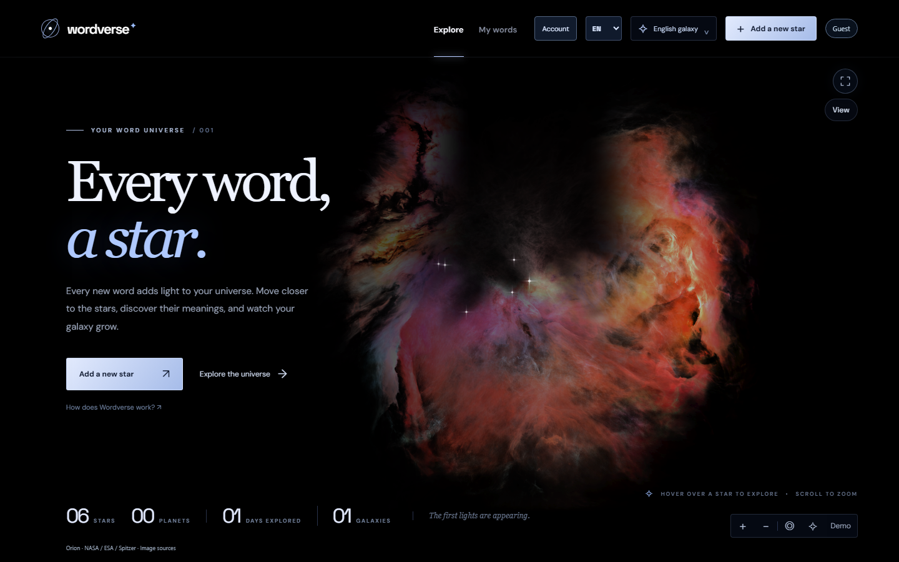
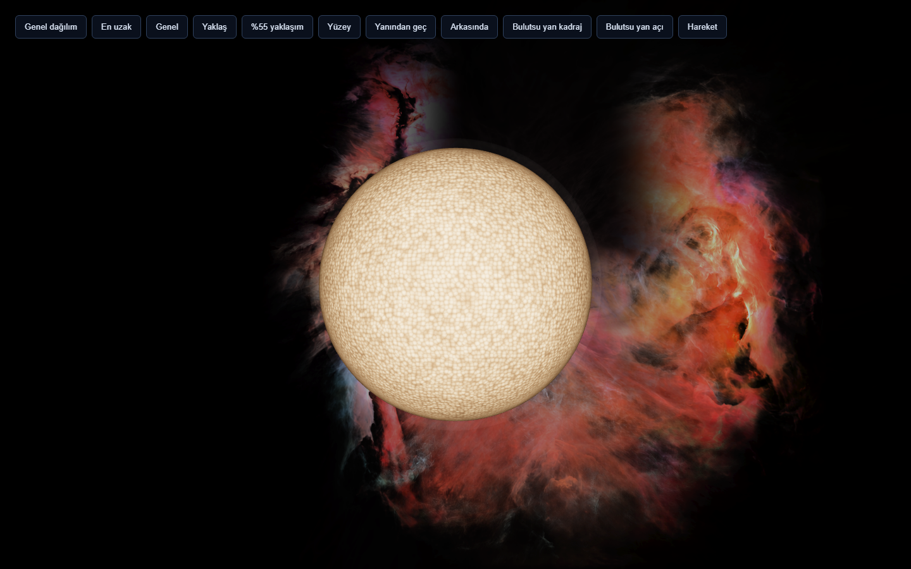
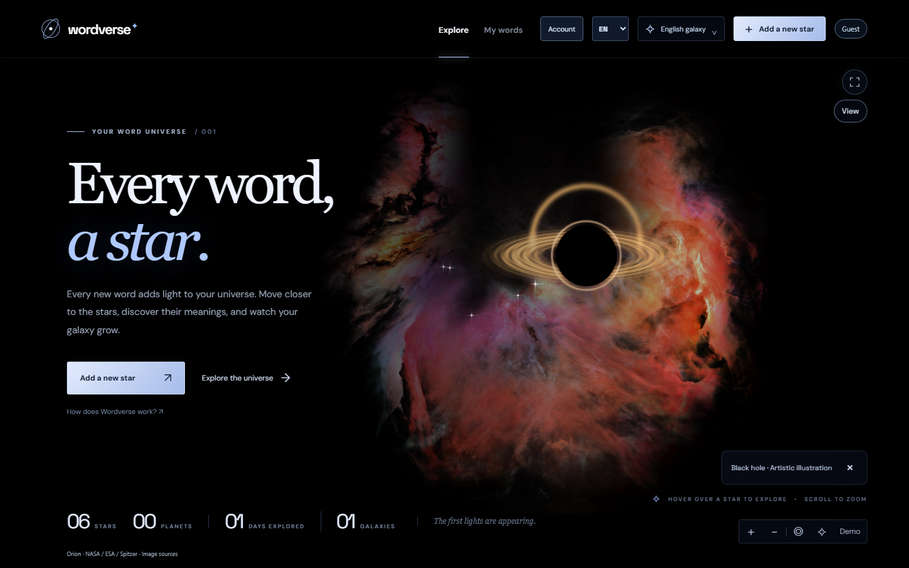

<p align="center"><strong>W O R D V E R S E</strong><br />A word. A star. A universe.</p>

<p align="center"><a href="https://wordverse-galaxy.vercel.app">Open Wordverse</a> · <a href="docs/GUIDE.tr.md">Türkçe rehber</a> · <a href="CONTRIBUTING.md">Contribute</a></p>



**Turn the words you learn into a universe you can explore.** Add a word, find its star, approach its surface and reveal its meaning when you are ready. Wordverse pairs a personal vocabulary atlas with a cinematic Three.js scene.

The live app runs **1.14.1**. The screenshots and features below describe **1.17.0 development** on [`phase/4-universe`](https://github.com/GhostFelina/wordverse-galaxy/tree/phase/4-universe), ahead of production. All gallery records are synthetic.

## Explore, remember, share

| Experience | What you can do |
| --- | --- |
| Your word stars | Keep words in language galaxies, select a star and approach its warm granular surface. Existing positions stay stable. |
| Orion flight | Travel through a continuous gas volume with the wheel, zoom buttons or depth slider. Return to your stars in one action. |
| A useful atlas | Search, filter words and conjunctions, sort naturally or by date, and return to the same list after opening a record. |
| Short recall | Reveal a meaning, self-assess and revisit difficult words. Sessions are ephemeral; this is not a spaced-repetition scheduler. |
| Star cards | Download a 1080px square or portrait PNG of one chosen word. Meanings stay off until explicitly included. |
| Quiet sky experiences | Choose a meteor, slowly expanding supernova or illustrative black-hole disk. Nothing starts automatically or changes your records. |
| Built for the browser | Turkish, English and Spanish; keyboard navigation, reduced motion, local fonts, adaptive graphics and an atlas fallback. |

<p> </p>

## Run the development app

Use **Node.js 24** and a current WebGL2 desktop browser. Guest learning works without a Supabase account or environment file.

```sh
git clone --branch phase/4-universe https://github.com/GhostFelina/wordverse-galaxy.git
cd wordverse-galaxy
npm ci
npm run dev -- --port 5360 --strictPort
```

Open [127.0.0.1:5360](http://127.0.0.1:5360). Drag to move; use the wheel or `+` / `−` to zoom. Select **Orion** to enter the cloud. **View → Sky experiences** opens the optional illustrations. `Home` returns to the initial view; `Escape` leaves the current panel or focus. `/` opens the atlas.

Optional device/service setup: [device setup](docs/handoff/CROSS_DEVICE.md). Account synchronization exists in the development branch; its wider rollout is separate from this desktop visual release.

## Your data stays yours

Guest records live in this browser, with an IndexedDB primary store and a local recovery copy. Storage is tied to the site address: localhost, previews and production have separate stores. Clearing all site data can remove both local copies. Download a JSON backup before moving or clearing a browser.

Account-owned data is isolated from guest data. An opt-in account can use Supabase synchronization; guest records are not silently uploaded. Card export renders locally and has no automatic social posting. See [security and reporting](SECURITY.md).

## How it is built

Three.js renders shared optical points, bounded close-surface meshes and a separately scaled Orion gas pass. Camera damping and explicit focus preserve existing word coordinates. Optional sky experiences use ephemeral state and one bounded shader pass. PNG cards reuse the detail star renderer without adding a continuous render loop.

The Orion guidance image is a **1254 × 1254 starless, AI-edited derivative** of telescope imagery. Volume depth, stellar convection and sky experiences are artistic interpretations, not calibrated physical simulations or live observations. A meteor is an atmospheric phenomenon; its sky overlay is an illustration. Deferred catalogs remain in the repository but are not active scene features.

- [Product specification](docs/PRODUCT_SPEC.md) · [Visual specification](docs/VISUAL_SPEC.md)
- [Asset provenance](docs/ART_ASSET.md) · [Attributions](ATTRIBUTIONS.md)
- [Roadmap](docs/ROADMAP.md) · [Changelog](CHANGELOG.md)

## Quality checks

```sh
npm run check          # lint, types, unit tests, build and browser flows
npm run format:check
npm run check:release
npm audit --audit-level=high
```

Install the test browser once with `npx playwright install chromium`. Fixtures use fake accounts and synthetic words. [Rendering evidence](docs/handoff/evidence/README.md) documents deterministic views and the limits of frame measurements. Hardware and software WebGL need separate review; one GPU's result is not a universal performance claim.

## Help build Wordverse

Focused contributions are welcome: accessible interactions, rendering improvements, robust vocabulary workflows and careful translations. Start with [CONTRIBUTING.md](CONTRIBUTING.md), or [report a reproducible issue](https://github.com/GhostFelina/wordverse-galaxy/issues/new/choose). Use synthetic examples rather than personal backups.

If Wordverse helps you learn, a star or a screenshot shared with a friend helps others discover it.

Application code is [MIT licensed](LICENSE). External imagery, catalog data and fonts keep their own licenses; see [ATTRIBUTIONS.md](ATTRIBUTIONS.md). NASA/ESA credits do not imply endorsement.
